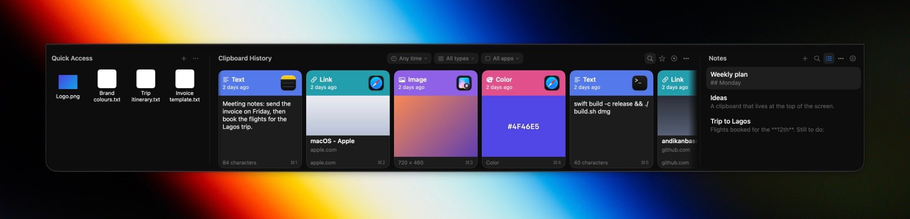
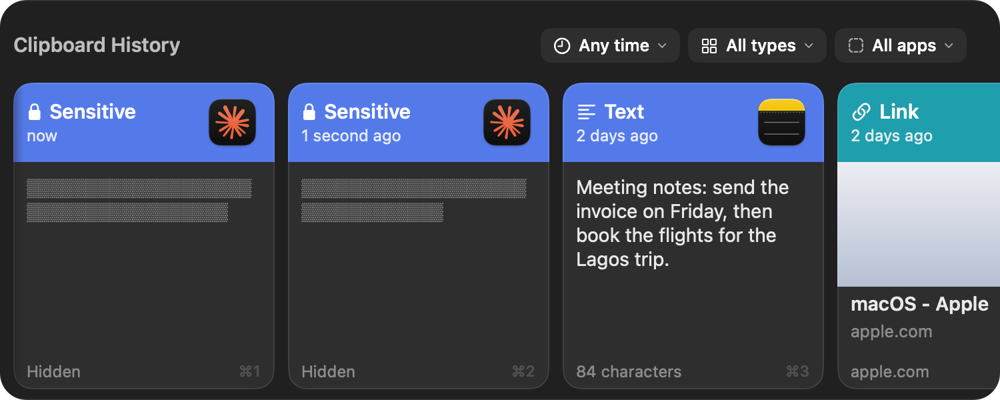
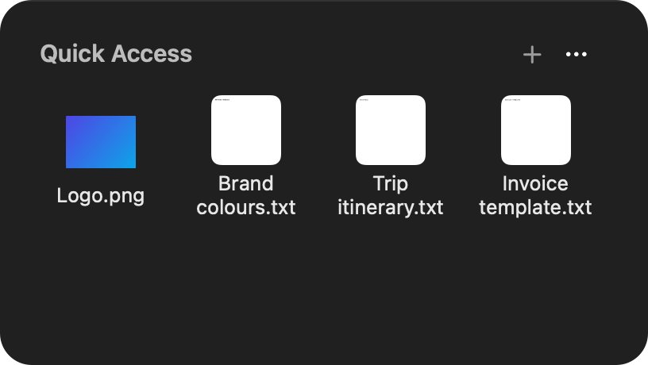
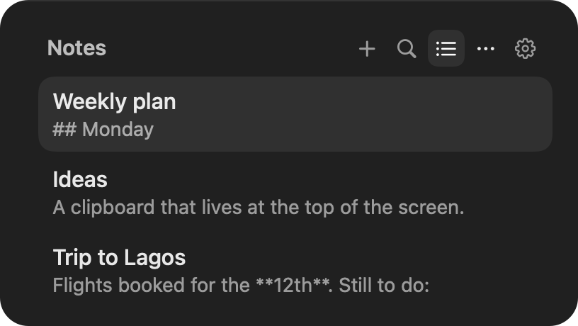
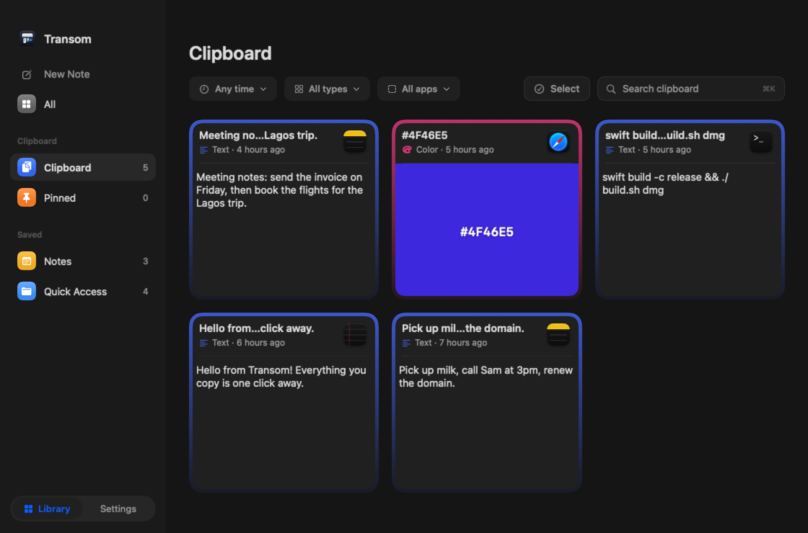
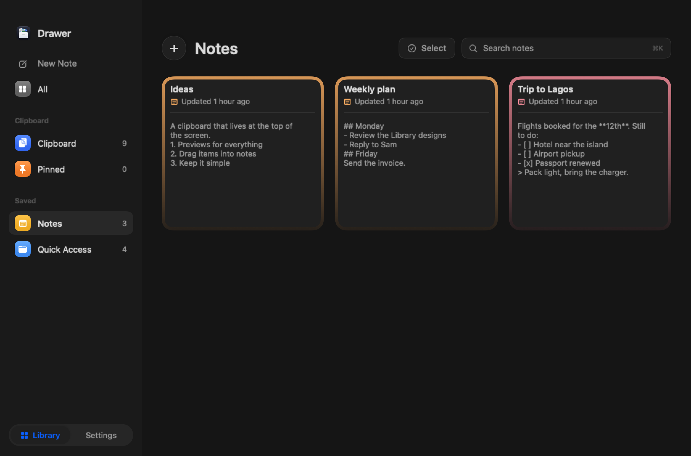
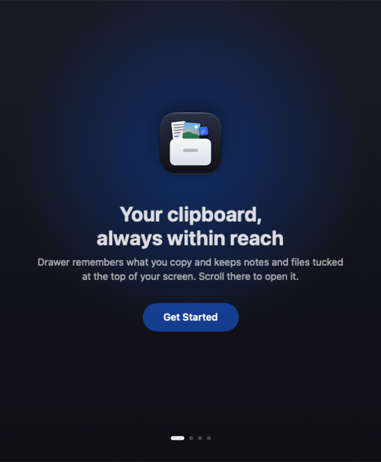
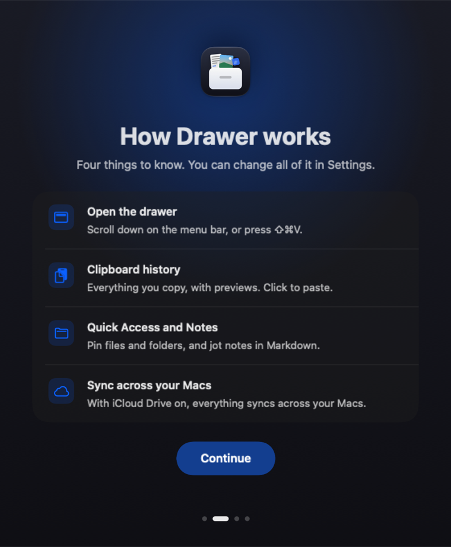
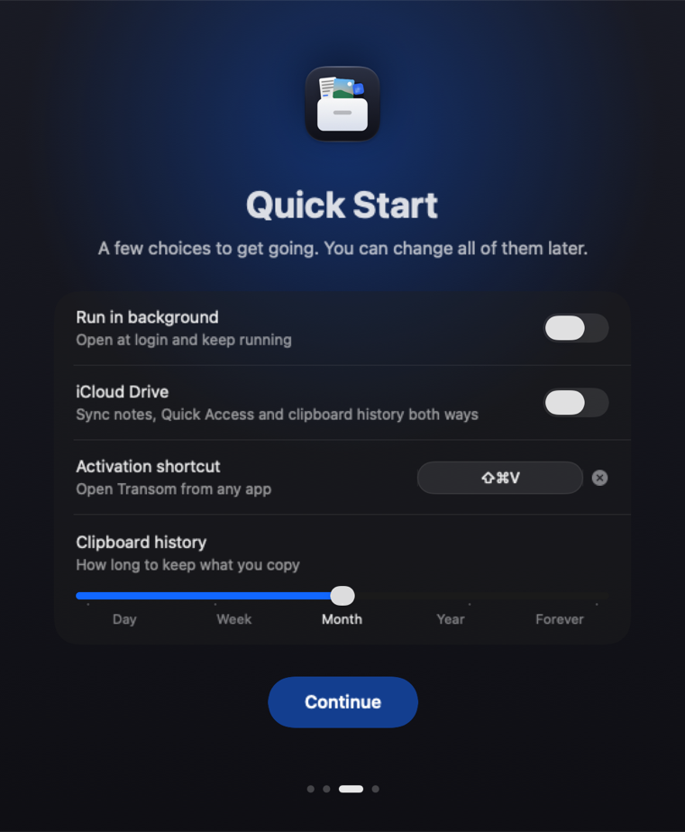
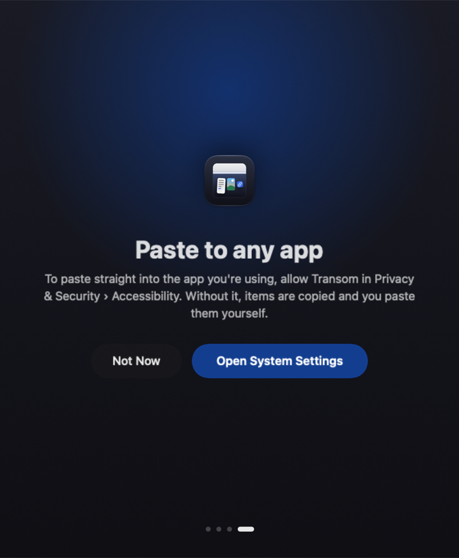

# Transom

A clipboard history, quick notes and pinned files, tucked behind the top edge of your screen on macOS.
Scroll at the top of the screen and Transom opens. Everything you copied is a click away, with real cover
images for pictures, videos, links and files.

Transom takes its layout from [Unclutter](https://unclutterapp.com) and its clipboard feature set from
[Paste](https://pasteapp.io). It is an independent project and is not affiliated with either.



> **Transom was called Drawer until 0.7.** Your history, notes and settings move across by themselves the first time the new app starts, and `drawer://` links keep working for a few releases.

> **Status:** early (v0.7). It is a native Swift app with no third-party dependencies.

## Features

### Opening and closing
- **Scroll down anywhere along the menu bar** to open (with a hidden menu bar, at the very top edge), swipe up over the top of Transom to close. Settings › Shortcuts can limit it to the top edge. The shortcut, hold-a-key and wait openers are there too.
- **Hold a key** or **wait** at the top edge, or press a **global hotkey** (⇧⌘V by default, rebindable).
- Stays open until you click outside it, or closes by itself after 5, 10 or 15 seconds if you prefer.
- Scroll direction can be inverted separately for mouse and trackpad.
- Right-click anywhere on Transom for pause, panel toggles and settings.

### Keyboard
- **← →** (cards) or **↑ ↓** (list) move through clipboard items, **Return** pastes, **⌥Return** pastes as plain text.
- **Space** previews the selected item, **Esc** steps back, then closes.
- **⌘F** searches, and so does simply starting to type.
- **⌘1–⌘9** quick paste still works as before.

### Clipboard history
- Every item gets a **cover image and a type pill**: text, link, colour, image, GIF, video, audio, PDF, folder or file.
- Real previews: first frame of videos and GIFs, first page of PDFs, page title and image for links,
  swatches for hex colours.
- Grouped by recency: Pinned, Past Hour, Today, Yesterday, This Week, This Month, Older.
- **Paste straight into the app you were using**, or just copy. ⌘1–⌘9 quick paste.
- Pin, search, and filter by **time, type and app** with three dropdowns; each item shows which app it came from.
- **Drag an item** onto Quick Access to keep it, or onto Notes to make a note from it (pictures are embedded).
- Copying the same picture again moves the earlier item to the top instead of storing it twice.
- History kept for a day, week, month, year or forever. Time is the only limit.
- Stored as one Markdown file per month, with formatting kept as Markdown, in the Clipboard folder.
- **Passwords and secret keys are masked** (scrambled text, a lock and "Sensitive"): still there to copy or paste, never shown, never saved.

<p>
  
</p>

### Quick Access
- Pin files and folders by dragging them in, or keep copies in a folder of your choice.
- Icon or list view, three item sizes, sort by name, kind, date added or date modified.
- Drag files back out to any app.

### Notes
- Notes are plain **Markdown files** in a folder you choose; pictures sit in an `Attachments` folder beside them.
- Opens on the list of your notes with a preview line each, remembers the note you were editing.

<table>
<tr>
<td width="50%" valign="top">

#### Quick Access



The files and folders you reach for most, one click away.

</td>
<td width="50%" valign="top">

#### Notes



Plain Markdown notes right beside your clipboard.

</td>
</tr>
</table>

### Library
- A bigger window for everything, opened from the menu bar: clipboard, pinned, notes and Quick Access, with search (⌘K) for the page you are on.
- **Select** several items to pin or delete them together, or pick "last 5 minutes", "last hour" or "today" and clear them in one go.
- Cards or lists, for everything or per kind. Settings sit one click away, behind the same window.

<table>
<tr>
<td width="50%" valign="top">

#### Library · Clipboard



Filter by time, type and app, then Select several items at once.

</td>
<td width="50%" valign="top">

#### Library · Notes



The same header and search on every page.

</td>
</tr>
</table>

### Privacy
- **Sensitive items stay hidden.** Passwords from password managers and secret keys (API tokens, private keys) still show up in the list so you can copy or paste them, but as scrambled text, never as the real thing. They are kept in memory only, never saved to disk or synced, and removed after 15 minutes. Turn this off to skip them entirely.
- Skips other items that apps flag as transient.
- Allow list and block list for the apps Transom records from.
- Optionally hide Transom from screen sharing.
- Link previews can be switched off. They download the page to get a title and image.
- Everything is stored locally. No accounts, no analytics. The only network use is link previews (off if you like), a once-a-day check for a new version on GitHub (off if you like; it sends only a request for the latest release) and the iCloud Drive sync you turn on yourself.
- Link cover images are kept on your Mac only, never in the synced folder.

### Look and feel
- Liquid Glass on macOS 26 and later, a blurred material on earlier versions.
- Dark, light or system theme, background opacity, height, camera-notch aware.
- Menu bar icon with pause, settings and quit. First-launch welcome screen.

### Updates
- Transom checks GitHub for a new release about once a day and tells you in the menu bar menu (and once in a dialog per version). **Update Now** downloads the DMG, checks it against the published checksum, replaces the app in place and reopens it. Your settings and Accessibility permission carry over. Turn the check off in Settings › General, or use **Check for Updates** in About any time.

### iCloud
- Pictures can be big: turn on **Keep pictures on this Mac** (Settings › Clipboard) and they never go into iCloud Drive. Other Macs keep the text and links, not the pictures. Clearing history deletes the pictures too.
- Keep notes and files in iCloud Drive with one switch. macOS syncs the folders between your Macs.

## Install

Transom needs **macOS 14 or later** on a Mac with Apple silicon (the download is built for arm64).

### Download

1. Download `Transom.dmg` from the [Releases](../../releases) page and open it.
2. Drag **Transom** into **Applications**, then open it.
3. **macOS will warn that it can't verify the app.** This is expected, and it is explained below.

#### Why macOS shows a warning

Transom is **not notarized by Apple yet**. Notarization needs a paid Apple Developer membership, which I don't have
at the moment. For any app that isn't notarized, macOS shows a standard warning along the lines of
*"Apple could not verify 'Transom' is free of malware that may harm your Mac or compromise your privacy."*
That message is about Apple not having checked the app. It does not mean anything was found in it. Notarization is on
the list for when it is available.

#### How to open it anyway (once)

- **macOS 15 (Sequoia) and later:** click **Done** on the warning, then open **System Settings › Privacy & Security**,
  scroll down to **Security**, and click **Open Anyway** next to "Transom was blocked". Confirm with your password or
  Touch ID, then click **Open**. You only need to do this the first time.
- **macOS 14 (Sonoma):** in **Applications**, right-click (or Control-click) **Transom**, choose **Open**, then **Open**.
- **Terminal alternative (any version):**

  ```bash
  xattr -dr com.apple.quarantine /Applications/Transom.app
  ```

  then open Transom normally. This only removes the flag macOS adds to downloaded files.

The wording and the position of buttons change a little between macOS versions.

#### Is it safe?

You don't have to take my word for it:

- **The source is here.** Transom is open source (MIT) and has no third-party dependencies. Read it, or build it yourself
  with the two commands below. An app you build yourself opens without any warning.
- **Check the download.** Each release lists a SHA-256 checksum. Compare it with
  `shasum -a 256 ~/Downloads/Transom.dmg`; they should match exactly.
- **What it can see.** The clipboard (that is the point of the app). **Accessibility** is requested only if you want
  items to paste straight into the app you were using; without it, items are copied and you paste yourself.
- **What it sends.** Nothing. Everything is stored on your Mac. The only network use is link previews (a setting you can
  switch off, which downloads the linked page to get a title and image), a once-a-day check for a new version on GitHub
  (Settings › General › Check for updates, also switchable; it sends nothing but a request for the latest release) and iCloud Drive sync if you turn it on, which
  macOS itself performs. There is no analytics or tracking. If that ever changes it will be disclosed and switchable.
- **Where your data lives.** Plain files in `~/Library/Application Support/Transom/`, or the iCloud Drive folders you pick.
  See [Data](#data). Delete the app and that folder to remove everything.

Updates are manual for now: download the new release and replace the app. Transom is signed with a fixed identity, so
macOS should keep the permissions you granted.

### Build from source

You need the Swift toolchain. The Xcode Command Line Tools are enough (`xcode-select --install`).

```bash
git clone <this repository>
cd <this repository>
./build.sh install     # builds, copies to /Applications and launches
```

Other targets:

```bash
swift test             # unit tests (history format, version comparison)
./build.sh             # build only: build/Transom.app
./build.sh run         # build and launch from build/
./build.sh dev         # fast debug build and launch, for trying changes
./build.sh zip         # build and write build/Transom.zip and its SHA-256 for sharing
./build.sh dmg         # build and write build/Transom.dmg and its SHA-256 for sharing
```

The first launch opens a short welcome.

### Signing

By default the app is signed ad-hoc with a fixed designated requirement
(`identifier "com.studioab.drawer"`), so macOS keeps the Accessibility permission across rebuilds.
To sign with a real certificate instead:

```bash
security find-identity -v -p codesigning
TRANSOM_SIGN_IDENTITY="Apple Development: Your Name (TEAMID)" ./build.sh install
```

### First launch

A short welcome explains how Transom works and asks for the one permission it needs. You can change everything later in Settings.

<p>
  
  
  
  
</p>

## Permissions

| Permission | Why | Required |
|---|---|---|
| Accessibility | Press ⌘V in the app you were using, so a chosen item pastes directly | Only for "paste into the app". Without it items are copied and you paste yourself |

Opening Transom by scrolling, holding a key, waiting or the hotkey needs no permission.

## Data

Stored in `~/Library/Application Support/Transom/`:

- `settings.json` for settings; `Clipboard/` (monthly Markdown files and an `Images/` folder) for clipboard history
- `Notes/` and `Files/` unless you pick other folders (or iCloud Drive) in Settings

## Project layout

```
Sources/Transom/
  main.swift          app entry, menu bar item, hotkey wiring
  Transom.swift        the panel: triggers, scroll, show and hide
  Views.swift         panel UI: clipboard, files and notes columns
  Clipboard.swift     clipboard model, capture, categories, previews
  Stores.swift        files and notes stores, shared app model
  Settings.swift      settings model, hotkeys, pasting
  SettingsView.swift  settings window
  Onboarding.swift    first-launch welcome
  Theme.swift         glass helper, button style, menu bar icon
build.sh              build, bundle, sign, install
make-icon.swift       draws the app icon
Transom.sdef           the AppleScript dictionary
```

Debug aids: `Transom --show` keeps it open, and `TRANSOM_SNAPSHOT=/path.png` renders it to an image.

## Automation

Off by default (Settings › Advanced › Automation). Once on, other apps and scripts can drive Transom.

**Links** (`open "transom://…"`; the old `drawer://` form still works):

| Link | Does |
|---|---|
| `transom://open`, `transom://close` | Show or hide Transom |
| `transom://search?q=invoice` | Open the Library on the clipboard with a search |
| `transom://pause`, `resume`, `toggle-pause` | Pause or resume capture |
| `transom://note?text=Hello` | Create a note |
| `transom://pin?index=1` | Pin a clipboard item (1 is the newest) |
| `transom://copy?index=1&plain=1` | Put an item back on the clipboard |
| `transom://paste?index=1&plain=1` | Paste an item into the app in front |

**AppleScript:** `clip count`, `get clip text 1`, `copy clip 1`, `paste clip 1`, `pin clip 1`, `pause capture`,
`resume capture`, `new note "…"`, `search clips "…"`, `open transom`. For example:
`osascript -e 'tell application "Transom" to get clip text 1'`. Scripts written for the old name (`tell application "Drawer"`) stop working: change the name to "Transom" and `open drawer` to `open transom`.

**Safety:** links that only change Transom always work once automation is on. Copying and pasting for another app needs
that app to be trusted (you are asked the first time; trusted apps are listed in Settings and can be removed).
Clipboard content can be read out only with AppleScript, never through a link.

## FAQ

**Is it free?** Yes. It is open source under the MIT licence.

**Does it send my clipboard anywhere?** No. There are no accounts and no analytics. See [Privacy](#privacy).

**Why does macOS warn me when I open it?** The app is not notarized yet. See [Why macOS shows a warning](#why-macos-shows-a-warning); it explains the steps and how to check the download.

**Where is my history stored?** As plain Markdown files, in `~/Library/Application Support/Transom/` or the iCloud Drive folder you pick. See [Data](#data).

**How do I use it on two Macs?** Turn on iCloud Drive in Settings. Notes, Quick Access and clipboard history then sync through the folders themselves.

**How do I remove it?** Delete Transom from Applications, then delete `~/Library/Application Support/Transom` (and the iCloud Drive `Transom` folder, or `Drawer` if you set sync up before the rename).

**How do I reset Transom?** Quit it, then delete `~/Library/Application Support/Transom` (your history, notes and settings) and run `defaults delete com.studioab.drawer` in Terminal (its preferences; the identifier is kept from the app's earlier name). Opening Transom again starts fresh with the welcome screen.

**I found a bug or have an idea.** Open an [issue](../../issues/new/choose) for a bug or a focused feature request, or start a [discussion](../../discussions/categories/ideas) for a rough idea or a question. *Settings › General › About* links to both.

## Roadmap

The full plan is in [ROADMAP.md](ROADMAP.md), and how releases are made is in [docs/releasing.md](docs/releasing.md).
In short:

**Shipped:** history with previews and filters, Quick Access, Notes, the Library, keyboard navigation, masked sensitive items,
iCloud sync, updates from GitHub, links and AppleScript.

**Now:** speed at any history size, more tests, a cleaner codebase, and checking on more setups.

**Next:** plain-text paste everywhere, text recognition in screenshots, pinboards, paste stack, a few text transforms, one-time
code handling, per-app rules, export, and Shortcuts.

**Later:** notarized releases, an iPhone and iPad companion, shared pinboards.

**Not doing:** accounts, cloud AI, or anything that sends clipboard content off your Mac.

## Credits

Inspired by Unclutter and Paste. Built with Swift, AppKit and SwiftUI.

## Author

Andikan Bassey · [contact@andikanbassey.com](mailto:contact@andikanbassey.com)

## License

[MIT](LICENSE) © 2026 Andikan Bassey
